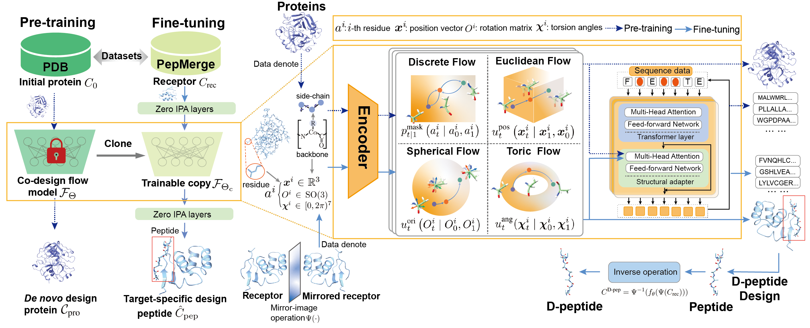

# D-Flow · PeptideDesign

Research code accompanying *D-Flow: Multi-modality Flow Matching for D-peptide Design*.

[Revised paper (v4)](https://arxiv.org/abs/2411.10618v4) · [Repository layout](#repository-layout) · [Citation](#citation)



## Repository layout

- [`dflow/`](dflow/) contains the project source and experiment configurations.
- [`openfold/`](openfold/) and [`ProteinMPNN/`](ProteinMPNN/) contain bundled upstream code.
- [`env.yml`](env.yml) and [`multiflow.yml`](multiflow.yml) record historical environments.
- [`setup.py`](setup.py) defines the Python distribution, including nested packages, configuration files, and the OpenFold resource file.

## Installation and package checks

Run package checks from the repository root in an isolated environment. The following builds the Python wheel and lists its contents.

```bash
python -m pip install build
python -m build --wheel
python -m zipfile -l dist/dflow-0.0.0-py3-none-any.whl
```

The wheel should include `dflow/`, `openfold/`, and `ProteinMPNN/`, along with `openfold/resources/stereo_chemical_props.txt`. This check covers the distribution contents. Runtime dependencies are managed separately.

## Historical environments

The environment YAML files are Linux/CUDA snapshots. In `env.yml`, the Conda section specifies CUDA 11.7 while the pip section pins PyTorch and torch-scatter builds for CUDA 12.1. Those pins need a consistent runtime to reproduce the environment. Check the installed PyTorch and CUDA build with:

```bash
python -c "import torch; print(torch.__version__, torch.version.cuda)"
```

The archived DeepSpeed version can encounter a missing `torch._six` on newer PyTorch releases. Treat that error as a dependency compatibility issue and keep dependency changes in the environment definition.

## Data references

The original documentation references a pretraining archive and the PepMerge release. Check data access with the repository maintainers. The pretraining snapshot used this repository-relative layout.

```text
<current_dir>
├── train_set
│   ├── processed_pdb
|   |   ├── <subdir>
|   |   |   └── <protein_id>.pkl
│   ├── processed_synthetic
|   |   └── <protein_id>.pkl
├── test_set
|   └── processed
|   |   ├── <subdir>
|   |   |   └── <protein_id>.pkl
...
```

PepMerge contains peptide–receptor examples collected from [PepBDB](http://huanglab.phys.hust.edu.cn/pepbdb/db/1cta_A/) and [Q-BioLiP](https://yanglab.qd.sdu.edu.cn/Q-BioLiP/Download), with structure and sequence files in the release.

## Citation

```bibtex
@article{wu2026d,
  title={D-flow: Multi-modality flow matching for d-peptide design},
  author={Wu, Fang and Jin, Shuting and Tang, Xiangru and Xu, Junlin and Gerstein, Mark and Li, Li Erran and Zou, James},
  journal={IEEE Journal of Biomedical and Health Informatics},
  year={2026},
  publisher={IEEE}
}
```

## Acknowledgments

D-Flow builds on [FrameFlow](https://github.com/microsoft/frame-flow), [MultiFlow](https://github.com/jasonkyuyim/multiflow), [PepFlow](https://github.com/Ced3-han/PepFlowww), and [ByProt](https://github.com/BytedProtein/ByProt).

For questions, contact [Fang Wu](mailto:fangwu97@stanford.edu).
